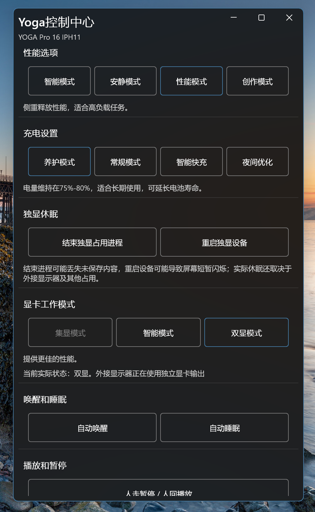
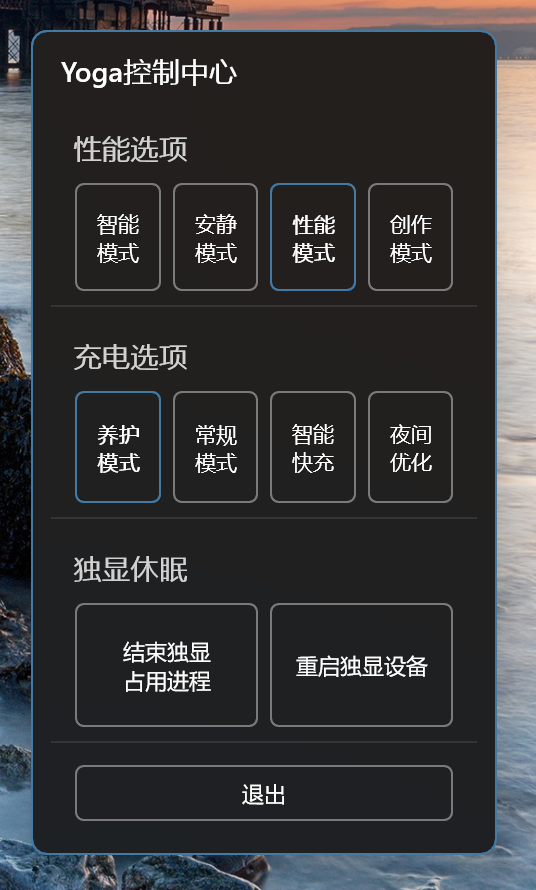

# Yoga控制中心（YogaITS）

一个驻留在 Windows 系统托盘中的联想笔记本控制中心，集中管理性能、充电、显卡、色彩和音频等设置。功能会根据当前设备及驱动能力自动显示或隐藏。

仅在 Yoga Pro 16 IPH11 上进行了完善测试，其他机型未经测试。

色彩管理已加入 TCON 路径，与原有 Yoga ICC 路径按实际能力自动选择。已在 ThinkBook 14 G6+ AHP、ThinkBook 14 G7+ IAH 上验证 P3/sRGB。Adobe RGB 的协议映射已确认，但尚无支持该能力的正样本完成实机验证。

## 开始使用

从 [GitHub Releases](https://github.com/wfsg00098/YogaITS/releases/latest) 下载 Windows x64 ZIP；推送主线后会自动构建并发布新版本。

运行环境：Windows 11 x64、.NET 10 Desktop Runtime、兼容的 Windows App Runtime，以及对应的联想硬件驱动和服务。程序需要管理员权限，启动时请允许 UAC 提示。

将已编译的程序完整解压到固定目录，双击 `YogaITS.Tray.exe` 启动。不要只复制 EXE，其他运行文件也需要保留。无需运行联想电脑管家，但不要卸载相关驱动和底层服务。

普通启动会自动打开完整窗口；开启“开机自启”后，登录时只显示托盘图标，不自动弹窗。如果之前已运行其他版本，请先从托盘退出旧版本。

程序默认向 Windows 请求节能显卡，双显卡设备通常使用核显；已有手动显卡偏好不会覆盖。首次设置可能在下次启动生效，单显卡设备使用现有显卡，实际选择由系统和驱动决定。

性能选项按驱动能力兼容新版及旧版联想 ITS 服务，不强制联动 Windows 的电源模式。旧版服务路径尚待小新 Pro IAH7 实机验证。

## 两种窗口

### 完整窗口：左键点击托盘图标

**左键点击系统托盘图标，弹出完整窗口。** 窗口已打开时，再次左键点击会关闭窗口，但程序继续驻留托盘。

完整窗口包含全部可用功能，可调整大小、滚动浏览。关闭窗口右上角的关闭按钮不会退出程序。



### 迷你窗口：右键点击托盘图标

**右键点击系统托盘图标，弹出迷你窗口。** 适合快速调整性能和充电设置、处理独显占用，底部提供“退出”按钮。

点击窗口外部或按 Esc 可关闭迷你窗口；点击“退出”才会结束程序。



## 功能说明

| 功能分组 | 可以做什么 |
| --- | --- |
| 性能选项 | 切换智能、安静、性能及受支持的极客/创作模式；极客/创作模式在电池供电时不可选择。 |
| 充电设置 | 选择养护、常规、智能快充或夜间优化。夜间优化与其他模式互斥，需要连接电源。 |
| 独显休眠 | 结束占用独显的进程，或重启独显设备，帮助独显进入休眠。 |
| 显卡工作模式 | 选择集显、双显或智能模式；智能模式根据供电和外接显示器状态自动调整。 |
| 唤醒和睡眠 | 控制自动唤醒、自动睡眠；开启自动睡眠后可选择速度及受支持的人员辅助判定。 |
| 播放和暂停 | 开启人走暂停、人回播放。 |
| 色彩管理 | 自动使用 TCON 硬件色域或 Yoga 工厂 ICC；按能力显示色域、HDR、ACM，ICC 路径另提供建议亮度和校色文件恢复。 |
| 扬声器降噪 | “仅保留人声”过滤播放内容中的其他声音。 |
| 麦克风降噪 | 选择关闭降噪、单人或多人通话；内置麦克风可按能力提供仅听机主、人声定位。 |
| 声纹管理 | 录制、读取或删除声纹，用于“仅听机主”；录制时可停止并丢弃本次内容。 |
| 开盖开机 | 控制打开笔记本盖子时自动开机，修改后需重启电脑生效。 |
| 杂项 | 开机自启、退出程序。 |

## 状态与使用注意

- 灰色边框表示未选中，强调色边框表示已选中。设置等待回读时，原选项和点击项可能同时显示强调色；完成后按实际状态显示，再更新说明。独显操作只在执行期间显示强调色。
- 窗口获得焦点时自动刷新，电源、显示器及音频设备变化也会更新对应状态，无需手动刷新。不支持的功能会隐藏，暂时不可用的选项会禁用。
- HDR 或 ACM 实际开启时，色域切换、亮度联动和在线恢复会隐藏。HDR 按钮只修改启用偏好，尊重 Windows 的电池供电 HDR 设置，界面显示实际状态。
- 只要系统报告 ACM 能力，HDR 开启或关闭、插电或电池供电时都可操作 ACM；ACM 卡片显示系统保存的启用设置，HDR 卡片显示实际 HDR 状态。色域控制始终按实际显示模式判断，实际是否生效由 Windows 决定。
- TCON 路径按屏幕能力显示 P3、sRGB、Adobe RGB，不提供 ICC 亮度联动或在线恢复；不支持的模式不会显示。Yoga ICC 路径保持原有配置名称及亮度功能。
- 插入耳机后，麦克风仅提供关闭降噪和单人通话。仅听机主需要先录制声纹；录制及注册期间不能修改麦克风或扬声器降噪。
- 结束独显占用进程按 LLT 的批量逻辑排除 `dwm.exe` 和 `explorer.exe`，其余占用进程连同子进程一起结束，包括系统和驱动进程，可能丢失未保存内容或影响相关服务。重启独显可能导致屏幕闪烁。使用前请保存工作，外接显示器和其他占用可能阻止独显休眠。
- 在线恢复会在确认后将本机序列号发送至 Lenovo 校色服务。声纹录制会使用麦克风；停止录制会丢弃本次录音，删除声纹前会再次确认。

## 自动更新

程序启动后在后台检查 GitHub 最新正式版，持续运行时每 24 小时检查一次。发现不同版本后，仅在完整窗口的“杂项”分组内显示卡片：

```text
新版本可用，点击进行更新
当前版本号 -> 新版本号
```

点击并确认后下载；优先直连 GitHub，连接失败、超时或下载过慢时使用 `https://gh-proxy.org/` 加速。下载完成并通过 SHA-256 校验后，程序退出、替换文件并重新启动。更新失败会保留或恢复旧文件，不改动设置、校色缓存及开机自启路径。检查失败不会弹窗或阻塞其他功能。

开发、构建及测试说明见 [DEVELOPMENT.md](DEVELOPMENT.md)。

